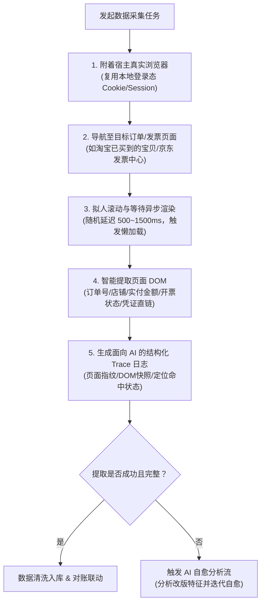

# Humanoid Browser Harvest & Self-Healing Loop (拟人化浏览器数据采集与自适应闭环技能)

## 技能背景与核心原则

当系统处于初期“未录入真实业务单据”阶段，必须由程序自主从淘宝、京东、拼多多等平台获取真实订单与发票数据。

### 1. 为什么坚决杜绝传统爬虫？
- 电商平台（尤其是阿里系、京东等）具备极强的反爬防御（设备指纹检测、请求头逆向加密、高频滑动拼图验证码）；
- 传统 `requests/urllib` 逆向接口极易被封禁，维护成本指数级飙升。

### 2. 核心范式：真人操作模拟 + 宿主 Cookie 复用
- **宿主浏览器接管**：通过 Chrome DevTools Protocol (CDP, 如 `--remote-debugging-port=9222`) 附着至财务或操作人员日常使用的真实浏览器，或复用本地用户目录（UserDataDir）；
- **天然免密与风控穿透**：直接沿用操作者在浏览器中已登录的 Cookie 会话、设备指纹与安全信任链，零登录暴露风险；
- **页面级渲染与拟人交互**：像真人一样触发页面滚动、等待异步前端组件渲染、点击展开浮层，分析真实 DOM 结构。

---

## 一、 拟人化采集作业规程 (SOP)



### 1. 浏览器会话接管要点
- 检查本地 Chrome/Edge 是否已开启调试端口，优先采用 CDP 附着模式：
  ```python
  # 优先复用当前已打开且登录的真实浏览器
  from playwright.sync_api import sync_playwright

  with sync_playwright() as p:
      browser = p.chromium.connect_over_cdp("http://localhost:9222")
      context = browser.contexts[0]
      page = context.pages[0] if context.pages else context.new_page()
  ```
- 若未启动调试实例，则采用持久化用户目录（UserDataDir）无缝启动。

### 2. 拟人化行为准则
- 严禁机械化突发超高频翻页，页面切换间隔加入高斯随机抖动（如 1.2s ± 0.4s）；
- 优先监听网络响应（`networkidle`）与关键 DOM 容器出现，而非盲目硬编码 `sleep`。

---

## 二、 面向 AI Agent 的专属 Trace 诊断留痕 (Agent-Centric Logging)

> [!IMPORTANT]
> **留痕设计的核心受众是 AI Agent 本身，而非普通人类业务人员。**
> 电商页面前端随时会重构改版。日志的本质是给 AI 提供**“现场还原切片”**与**“诊断病历”**，以便 AI 自主发现 DOM 变迁并重构提取逻辑。

### 1. 存储规范
- 根据项目准则，临时运行 Trace 与分析切片收敛保存在根目录下的 `temp/browser_traces/` 目录；
- 每次采集生成一份独立的结构化诊断文件：`trace_{platform}_{timestamp}.json`。

### 2. Trace 记录字段结构规范
```json
{
  "trace_version": "1.0",
  "timestamp": "2026-10-10T17:30:00+08:00",
  "platform": "taobao",
  "target_url": "https://buyertrade.taobao.com/trade/itemlist/list_bought_items.htm",
  "viewport_state": {
    "title": "已买到的宝贝",
    "is_logged_in": true,
    "current_page": 1
  },
  "dom_fingerprint": {
    "total_order_containers_detected": 15,
    "selector_health": {
      "order_card_container": {"selector": "div[data-id]", "hit_count": 15, "status": "healthy"},
      "invoice_button": {"selector": "button.invoice-action", "hit_count": 0, "status": "DRIFT_SUSPECTED"}
    }
  },
  "failure_context": {
    "failed_step": "extract_invoice_status",
    "error_type": "SelectorNotFound",
    "snapshot_html_snippet": "<div class=\"order-actions\"><span class=\"ant-btn-link\">查看发票</span></div>",
    "inferred_cause": "平台前端从原生 button 升级为 ant-design 浮动链接组件"
  }
}
```

---

## 三、 AI 自适应自愈闭环规程 (Closed-Loop Self-Healing)

当电商前端改版或防爬规则微调导致采集异常时，AI Agent 按照以下闭环流程自愈：

```
┌─────────────────────────────────────────────────────────────┐
│                 AI Agent 闭环自愈四步法                      │
├───────────────────┬─────────────────────────────────────────┤
│ 1. 察觉异动       │ 扫描 temp/browser_traces/ 最新的失败 Trace │
│    (Sensing)      │ 锁定命中率为 0 的选择器与 failure_context │
├───────────────────┼─────────────────────────────────────────┤
│ 2. 结构比对       │ 分析 Trace 中保留的 snapshot_html_snippet │
│    (Diffing)      │ 识别前端组件变化（如 class、tag、属性演变）│
├───────────────────┼─────────────────────────────────────────┤
│ 3. 策略自愈       │ 重新制定自适应弹性选择器（如文本锚定/       │
│    (Healing)      │ 多候选 fallback / XPath 层级模糊匹配）  │
├───────────────────┼─────────────────────────────────────────┤
│ 4. 回归生效       │ 重新在目标页面重放校验，通过后更新正式代码│
│    (Verification) │ 形成自适应演进的自愈闭环                │
└───────────────────┴─────────────────────────────────────────┘
```

### 1. 弹性选择器编写准则
- 避免对电商平台动态哈希类名（如 `.css-1x8g2`）产生硬依赖；
- 采用语义化属性或多重候选机制：
  ```python
  # 推荐：弹性候选匹配器
  INVOICE_SELECTORS = [
      "text='查看发票'",
      "text='申请开票'",
      "a:has-text('发票')",
      "[data-action*='invoice']"
  ]
  ```

### 2. 循环演进交付
- 当 AI 自愈修复采集逻辑后，保留修复前后的对比记录至 Trace 分析摘要，为后续维护积累自适应特征库。
