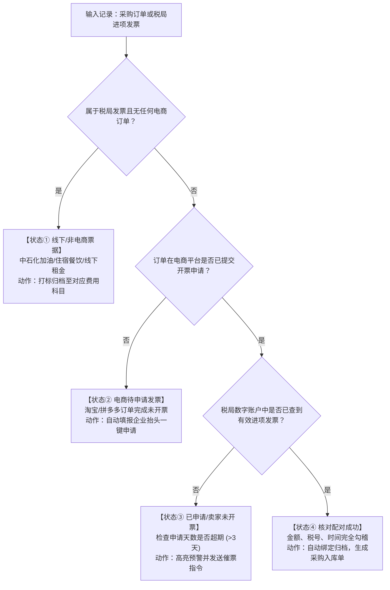

# Invoice Operations & Reconciliation Skill (发票运营与核验技能)

## 技能概述
本技能定义了 OPC Auto 系统的财务人员与 AI Agent 在处理企业采购进项发票时的标准化作业规程（SOP）。
涵盖电商平台（淘宝、京东、拼多多）订单提取、税局数电票勾稽、四大状态判定分流及每日报告总结。

---

## 一、 核心对账四分流判别准则 (Decision Matrix)

在进行数据比对时，严格遵循以下优先级与判定逻辑：



---

## 二、 关键匹配要素与容差规则 (Matching Rules)

1. **绝对匹配要素 (Hard Match)**：
   - **价税合计总金额**：必须完全相等（`order.pay_amount == invoice.total_amount`），容差为 0.00 元；
   - **购买方纳税人识别号**：必须为本企业统一信用代码（`91310000XXXXXXXXXX`）。
2. **启发式/自适应匹配要素 (Soft Match)**：
   - **开票日期与下单日期**：发票开票日期通常滞后于下单日期 0 ~ 30 天；
   - **商户名称映射 (Alias Mapping)**：
     - 电商店铺名（如“得力办公旗舰店”）与税局开票销方（如“得力集团有限公司”）可能存在字面差异；
     - 需查阅供应商别名映射表，若首次匹配需记录学习。

---

## 三、 各采购平台专用跟票排查规程

- **淘宝 / 天猫**：
  - 重点核对买家已买订单详情中的【开票信息】浮层；
  - 若为第三方小店铺，优先使用 Wiki 中的标准催票话术联系旺旺客服。
- **京东商城 (JD)**：
  - 京东自营：直接在【我的发票】下载 PDF 发票，自营发票 99% 会在妥投后自动进入税局底账；
  - 京东第三方 POP：需在发票中心确认是否已点击“申请开票”。
- **拼多多 (PDD)**：
  - 拼多多很多订单需要人工在售后页获取开票链接，若超 3 天未开具，标记为“高风险待人工跟进”。
- **线下费用发票 (状态①)**：
  - 加油发票：核对中国石化“易捷加油”或中国石油“好客e站”的车辆卡号消费记录；
  - 差旅出行：核对滴滴行程单或 12306 铁路客运电子发票。

---

## 四、 每日巡检总结报告格式规范 (Daily Audit Report Format)

每日晚间 21:00 任务执行完毕后，必须生成如下标准格式的 Markdown 日报：

```markdown
# 📑 OPC Auto 每日发票巡检与对账日报 (YYYY-MM-DD)

### 一、 核心指标总览
- 纳入对账总笔数：XX 笔 | 总金额：￥XX.XX 元
- 进项闭环匹配率：XX.X%
- 异常待催促总数：XX 笔

### 二、 四大状态分类清单
1. 🟢 **状态④ 核对配对成功**：XX 笔 (￥XX.XX 元)
2. 🟡 **状态② 电商待申请发票**：XX 笔 (￥XX.XX 元)
3. 🔴 **状态③ 已申请未到票 (超期预警)**：XX 笔 (￥XX.XX 元)
   - 订单号 [TBxxxx] 商家 [xxx] 已申请 X 天未开票
4. 🟣 **状态① 线下/其他费用票据**：XX 笔 (￥XX.XX 元)
   - 加油费 XX 笔、差旅住宿 XX 笔

### 三、 建议明日优先待办事项
- [ ] 针对状态③中超期商家发起二次人工/自动催票
- [ ] 针对状态②待申请订单批量提报抬头
```

---

## 五、 关联知识库参考
- 详细开票抬头要素：[01_企业开票信息与抬头规范.md](file:///d:/Software/opc_auto/wiki/01_企业开票信息与抬头规范.md)
- 各电商与线下平台指南：[02_采购平台与发票获取指南.md](file:///d:/Software/opc_auto/wiki/02_采购平台与发票获取指南.md)
- 税务局数电票底账与查验：[03_电子税务局与数电票查验指南.md](file:///d:/Software/opc_auto/wiki/03_电子税务局与数电票查验指南.md)
