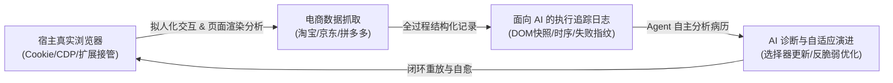

# OPC Auto - 企业轻量级 ERP 与运营自动化中台 (ERP & Automation Platform)

## 📌 项目定位
本项目旨在构建公司内部一体化、模块化、高可扩展的**轻量级企业资源计划（Lightweight ERP）与办公运营自动化中台**。
系统通过统一的 Web 门户整合各业务应用，实现从**“供应商管理 ➔ 采购下单 ➔ 进项发票跟踪 ➔ 仓储库存 ➔ 客户管理 ➔ 销售出库”**的全链路业务闭环与自动化对账。

## 🏛️ 核心架构范式与顶层要求 (Core Architectural Paradigms)

系统在“未预先录入真实业务单据”的初始阶段，以**自主采集与自适应迭代**为核心生命力，坚决贯彻以下三大顶层技术框架要求：



### 1. 拟人化真实浏览器驱动与会话复用 (Humanoid Browser Automation)
- **非传统逆向爬虫**：传统逆向 API 或无头 Request 爬虫在淘宝、京东等强风控平台极易被拦截封锁。系统采用**拟人化浏览器操控**（基于 CDP 端口附着、本地 UserDataDir 复用或专用自动化驱动）。
- **宿主会话天然继承**：直接复用操作人员真实浏览器内的登录 Cookie、设备指纹与安全凭证，零额外登录摩擦，天然规避人机滑块与账号封控。
- **页面级渲染分析**：像真人浏览一样驱动页面滚动、触发异步渲染、智能等待并解析前端 DOM 结构，提取真实的采购订单与开票进度。

### 2. 面向 AI Agent 的执行可观测性与追踪留痕 (Agent-Centric Trace Logging)
- **专属诊断留痕**：每一次抓取与交互全过程均生成深度结构化的 Trace 日志（包含操作步骤、页面 URL 状态、选择器命中率、关键 DOM 片段快照及异常响应特征）。
- **机器首要消费原则**：**该日志的核心受众是 AI Agent 本身，而非供人类业务员阅读。** 日志作为系统的“运行病历”，专供智能体随时查阅和比对历史执行表现。

### 3. 页面变迁下的自适应自愈闭环 (Self-Healing & Closed-Loop Adaptation)
- **拥抱前端动态变迁**：电商平台前端结构频繁重构与迭代是客观常态，系统设计必须具备反脆弱性。
- **闭环自我演化**：
  1. **捕获变异**：当抓取发生异常或选择器漂移时，自动封存当前失败上下文；
  2. **智能诊断**：AI Agent 读取并分析详细 Trace，定位变动的 DOM 结构或失效逻辑；
  3. **自愈迭代**：针对性更新抓取脚本与定位策略，形成**“运行 ➔ 追踪留痕 ➔ AI 诊断 ➔ 脚本自愈 ➔ 验证生效”**的完整自适应闭环。

---

## 📂 项目文档索引

| 编号 | 文档名称 | 状态 | 核心内容 |
| :---: | :--- | :---: | :--- |
| **00** | [系统总体架构与业务矩阵设计 (ERP+自动化全貌)](file:///d:/Software/opc_auto/docs/00_系统总体架构与业务矩阵设计_ERP.md) | 🟢 已发布 | 供应商、客户、库存、财务四大模块联动全景及数据流闭环 |
| **01** | [财务部 - 采购进项发票智能跟踪与核对系统 PRD](file:///d:/Software/opc_auto/docs/01_财务发票跟踪系统需求说明书.md) | 🟡 细化中 | 淘宝采购抓取、电子税局同步、四类发票智能核对与每日定时报告 |
| **02** | [多平台采购发票采集方案头脑风暴与技术路线选型](file:///d:/Software/opc_auto/docs/02_多平台采购发票采集方案头脑风暴与技术路线选型.md) | 🟣 讨论中 | 淘宝/京东/拼多多授权门槛、API vs RPA vs 插件对比、风控规避方案 |
| **03** | [系统自我迭代闭环实施方案 (数据与代码自演化)](file:///d:/Software/opc_auto/docs/03_系统自我迭代闭环实施方案_数据与代码自演化.md) | 🟢 已发布 | 双阶段时钟（采集+自愈）、面向 AI 的 Trace 留痕、代码与规则自进化机制 |

---

## 📚 企业运营知识库 (Wiki)
系统持久化知识库统一存放于 `wiki/` 目录：
- 📑 **Wiki 总索引**：[wiki/README.md](file:///d:/Software/opc_auto/wiki/README.md)
- 🏢 **企业开票抬头与规范**：[01_企业开票信息与抬头规范.md](file:///d:/Software/opc_auto/wiki/01_企业开票信息与抬头规范.md)
- 🛒 **外部采购平台与发票获取指南**：[02_采购平台与发票获取指南.md](file:///d:/Software/opc_auto/wiki/02_采购平台与发票获取指南.md) (淘宝、京东、拼多多、1688、中石化/中石油等)
- 🏛️ **国家电子税务局与数电票查验指南**：[03_电子税务局与数电票查验指南.md](file:///d:/Software/opc_auto/wiki/03_电子税务局与数电票查验指南.md)

---

## 🧠 运营技能与自动化规程 (Skills)
- ⚡ **发票对账与运营专属技能**：[`invoice-ops`](file:///d:/Software/opc_auto/.agents/skills/invoice-ops/SKILL.md) (标准化四分类对账决策矩阵、电商平台排查技巧、日报模板)
- 🤖 **拟人化浏览器采集与自愈技能**：[`humanoid-browser-harvest`](file:///d:/Software/opc_auto/.agents/skills/humanoid-browser-harvest/SKILL.md) (真实浏览器接管与 Cookie 复用、面向 AI 的结构化 Trace 留痕、页面变迁自适应演进)

---

## 🚀 服务启动与 24 小时常驻运行指引 (24/7 Service)

系统支持作为**24小时外部服务常驻运行**，同时内部配备低资源消耗的**定时巡检守护线程**（可在 Web 页面随时配置每晚 19:00 或 21:00 自动执行）。

### 方式 1：双击一键启动 (推荐，带浏览器自动打开)
- 双击运行根目录下的 [`run.bat`](file:///d:/Software/opc_auto/run.bat)
- 系统将自动拉起 Python 后台服务，并自动打开浏览器访问：**[http://localhost:8088](http://localhost:8088)**

### 方式 2：无黑窗口静默常驻 (真正 24 小时后台运行)
- 双击运行根目录下的 [`start_daemon.vbs`](file:///d:/Software/opc_auto/start_daemon.vbs)
- 服务将完全静默在 Windows 后台 24 小时运行，即使关闭任何控制台窗口也不会退出。
- 如需停止服务，双击运行 [`stop.bat`](file:///d:/Software/opc_auto/stop.bat) 即可。

### 方式 3：命令行直接启动
```bash
python server.py
```

---

## ⏰ 每日定时巡检与时间配置 (Configurable Scheduler)
- **常驻 Web 服务 vs 定时巡检**：外部 Web 门户保持 24 小时随时可用；而耗费网络资源的电商与税局对账则由内置调度器定时触发。
- **动态修改定时时间**：
  - 在 Web 门户界面左侧点击 **`⚙️ 定时巡检任务状态`**；
  - 随时切换为 **晚上 19:00 (7点)**、**晚上 20:00 (8点)** 或 **晚上 21:00 (9点)**；
  - 也可直接自定义任意时间（如 `18:30`），点击保存立即生效，无需重启服务！

---

## 🏗️ 核心业务模块全景 (Business Matrix)

```
┌────────────────────────────────────────────────────────────────────────┐
│                   OPC Auto 统一 Web 门户底座 (Portal)                  │
├─────────────┬─────────────┬──────────────────────────┬─────────────────┤
│ 👥 客户管理 │ 🏭 供应商   │ 📦 库存管理 (Inventory)  │ 💰 财务与对账   │
│   (CRM)     │ 管理 (SRM)  │                          │    (Finance)    │
├─────────────┼─────────────┼──────────────────────────┼─────────────────┤
│ • 客户档案  │ • 供应商建档│ • 商品/物料目录(SKU)     │ • 进项发票跟踪  │
│ • 开票抬头  │ • 税号/账号 │ • 采购入库绑定           │ • 淘宝订单对账  │
│ • 销售跟进  │ • 店铺映射  │ • 销售出库/调拨          │ • 税局底账核对  │
│ • 应收账款  │ • 应付账款  │ • 库存预警与盘点         │ • 每日定时报表  │
└─────────────┴─────────────┴──────────────────────────┴─────────────────┘
```

---

## 🗓️ 迭代推进计划
1. **第一阶段（当前核心攻坚）**：
   - 财务进项发票跟踪与核对自动化引擎（淘宝订单 + 电子税务局底账 + 每日定时任务）。
   - 基础供应商主数据（支持淘宝店铺/税局销方名称与供应商自动映射）。
2. **第二阶段**：
   - 基础库存管理（采购关联入库、SKU 物料维护）。
   - 基础客户管理（客户档案、开票抬头、应收台账）。
3. **第三阶段**：
   - Web 统一工作台门户（Portal 聚合看板、权限体系、多应用单点接入）。
