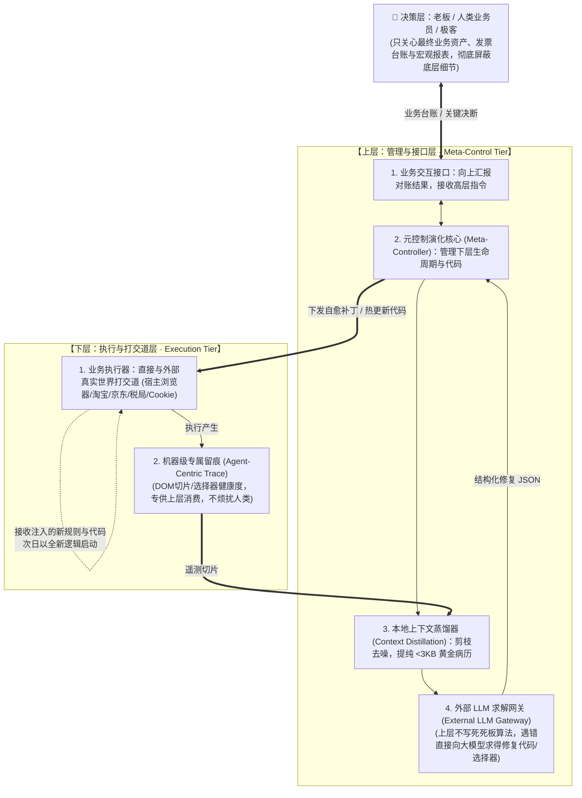

# OPC Auto - 企业轻量级 ERP 与运营自动化中台 (ERP & Automation Platform)

## 📌 项目定位
本项目旨在构建公司内部一体化、模块化、高可扩展的**轻量级企业资源计划（Lightweight ERP）与办公运营自动化中台**。
系统通过统一的 Web 门户整合各业务应用，实现从**“供应商管理 ➔ 采购下单 ➔ 进项发票跟踪 ➔ 仓储库存 ➔ 客户管理 ➔ 销售出库”**的全链路业务闭环与自动化对账。

## 🏛️ 最顶层核心架构：双层元控制与 LLM 脑力自愈闭环 (Two-Tier Meta-Healing Architecture)

系统在“未预先录入真实业务单据”的实战背景下，将**“双层世界模型”与“外接 LLM 脑力自愈”**作为全系统的最顶层设计哲学：



### 1. 明确双层世界职责边界
- **下层（执行层）专干脏活**：直接接管宿主真实浏览器（CDP 端口附着，天然复用已登录 Cookie 与安全凭证），模拟真人行为抓取电商订单与发票；全过程产生高密度机器 Trace，**绝不拿海量报错烦扰老板**。
- **上层（元控制层）统揽全局**：
  - **向上（面向人）**：认知降噪，只向老板汇报纯净的四状态对账结果与决策事项；
  - **向下（面向代码）**：动态注入规则与热补丁，实现**“今天运行的程序与明天运行的程序可能完全不一样”**。

### 2. 外部 LLM 脑力求解与本地上下文蒸馏
- **外脑挂接**：上层不依靠写死死板的硬编码规则穷举改版，而是通过标准化网关（支持 Gemini 2.5 / OpenAI / 私有化 Ollama）实时求解；
- **本地上下文蒸馏 (Context Distillation)**：海量底层日志绝不全量倾倒给 AI！本地在毫秒级执行**敏感脱敏、CSS/SVG 剪枝、重复卡片压缩**，只向大模型提交 `< 3KB` 的“失效字段 + 目标语义锚点 + 局部骨架 DOM”，使大模型注意力高度聚焦，秒级输出高精度自愈选择器。

### 3. 自愈行为边界准则：只做“修复性自愈”，坚决不做“净化性自愈” (Healing Boundaries)
系统严格确立自愈的权限与行动边界，杜绝 AI 权力失控：
- 🟢 **只做修复性自愈 (Corrective Self-Healing Only)**：
  - 目标极度聚焦：**当且仅当既定业务采集链路发生断裂或选择器失效时，被动触发修复**；
  - 核心职责是维持数据采集与对账的连续性（修选择器、补全候选链、调整等待时序）。
- 🛑 **坚决不做净化性自愈 (No Sanitizing/Pruning Self-Healing)**：
  - **严禁 AI 擅自猜测性删除未使用的 UI 按钮、修剪业务表单或废弃后端路由**；
  - 净化、功能下线与死代码剔除属于**战略级业务决策**，必须由人类/老板在交互式确认下主导执行。
- ⚖️ **关于演化到一定程度后的自主重构问题 (Refactoring Boundary)**：
  - **本次核心目标不包含“全自主架构级重构”**；
  - 系统通过“核心代码极其稳定、变动收敛至外部规则库 (`rules_evolution.json`)”的分层设计，避免核心源码腐化；
  - 未来若规则库历史补丁累积过多，上层采用**“出具重构建议提案 (Refactoring Proposal)”**模式，由人类确认后再行实施，防止代码库在深夜脱离人类监督产生架构漂移。

---

## 📂 项目文档索引

| 编号 | 文档名称 | 状态 | 核心内容 |
| :---: | :--- | :---: | :--- |
| **00** | [系统总体架构与业务矩阵设计 (ERP+自动化全貌)](file:///d:/Software/opc_auto/docs/00_系统总体架构与业务矩阵设计_ERP.md) | 🟢 已发布 | 供应商、客户、库存、财务四大模块联动全景及数据流闭环 |
| **01** | [财务部 - 采购进项发票智能跟踪与核对系统 PRD](file:///d:/Software/opc_auto/docs/01_财务发票跟踪系统需求说明书.md) | 🟡 细化中 | 淘宝采购抓取、电子税局同步、四类发票智能核对与每日定时报告 |
| **02** | [多平台采购发票采集方案头脑风暴与技术路线选型](file:///d:/Software/opc_auto/docs/02_多平台采购发票采集方案头脑风暴与技术路线选型.md) | 🟣 讨论中 | 淘宝/京东/拼多多授权门槛、API vs RPA vs 插件对比、风控规避方案 |
| **03** | [系统自我迭代闭环实施方案 (数据与代码自演化)](file:///d:/Software/opc_auto/docs/03_系统自我迭代闭环实施方案_数据与代码自演化.md) | 🟢 已发布 | 双阶段时钟（采集+自愈）、面向 AI 的 Trace 留痕、代码与规则自进化机制 |

---

## 📚 企业运营知识库 (Wiki)
系统持久化知识库统一存放于 `wiki/` 目录：
- 📑 **Wiki 总索引**：[wiki/README.md](file:///d:/Software/opc_auto/wiki/README.md)
- 🏢 **企业开票抬头与规范**：[01_企业开票信息与抬头规范.md](file:///d:/Software/opc_auto/wiki/01_企业开票信息与抬头规范.md)
- 🛒 **外部采购平台与发票获取指南**：[02_采购平台与发票获取指南.md](file:///d:/Software/opc_auto/wiki/02_采购平台与发票获取指南.md) (淘宝、京东、拼多多、1688、中石化/中石油等)
- 🏛️ **国家电子税务局与数电票查验指南**：[03_电子税务局与数电票查验指南.md](file:///d:/Software/opc_auto/wiki/03_电子税务局与数电票查验指南.md)
- 🧠 **双层架构与自愈评估**：[04_面向老板与面向代码的双层自愈体系总结.md](file:///d:/Software/opc_auto/wiki/04_面向老板与面向代码的双层自愈体系总结.md) (老板业务视角与代码自愈解耦、外接 AI 脑力自愈论证)
- 🔬 **LLM 交互与上下文蒸馏**：[05_自愈引擎与LLM交互规范_上下文蒸馏与通道设计.md](file:///d:/Software/opc_auto/wiki/05_自愈引擎与LLM交互规范_上下文蒸馏与通道设计.md) (海量日志去芜存菁清单、局部骨架 DOM 剪枝提取与 API 通道设计)

---

## 🧠 运营技能与自动化规程 (Skills)
- ⚡ **发票对账与运营专属技能**：[`invoice-ops`](file:///d:/Software/opc_auto/.agents/skills/invoice-ops/SKILL.md) (标准化四分类对账决策矩阵、电商平台排查技巧、日报模板)
- 🤖 **拟人化浏览器采集与自愈技能**：[`humanoid-browser-harvest`](file:///d:/Software/opc_auto/.agents/skills/humanoid-browser-harvest/SKILL.md) (真实浏览器接管与 Cookie 复用、面向 AI 的结构化 Trace 留痕、页面变迁自适应演进)

---

## 🚀 服务启动与 24 小时常驻运行指引 (24/7 Service)

系统作为 **24 小时 Web 服务常驻运行**；**每日定时调度由 Trae 外部自动化托管**（系统内置调度器已移除，避免双轨维护）。

### 方式 1：双击一键启动 (推荐，带浏览器自动打开)
- 双击运行根目录下的 [`run.bat`](file:///d:/Software/opc_auto/run.bat)
- 系统将自动拉起 Python 后台服务，并自动打开浏览器访问：**[http://localhost:8088](http://localhost:8088)**

### 方式 2：无黑窗口静默常驻 (真正 24 小时后台运行)
- 双击运行根目录下的 [`start_daemon.vbs`](file:///d:/Software/opc_auto/start_daemon.vbs)
- 服务将完全静默在 Windows 后台 24 小时运行，即使关闭任何控制台窗口也不会退出。
- 如需停止服务，双击运行 [`stop.bat`](file:///d:/Software/opc_auto/stop.bat) 即可。

### 方式 3：命令行直接启动
```bash
python server.py
```

---

## ⏰ 每日定时调度 (由 Trae 自动化托管)

每日凌晨 01:00 由 Trae 定时自动化触发唯一编排入口 [`src/cron_daily.py`](file:///d:/Software/opc_auto/src/cron_daily.py)（`python -m src.cron_daily`），单时钟合并执行链：

1. **业务采集与对账巡检**：避开晚间网络拥挤与风控峰值，夜间拟人化完成电商订单与税局数据抓取与交叉对账；
2. **自愈演化（采集完成后立即触发）**：AI 自愈引擎自动复盘本次采集产生的 Trace 档案，演化更新规则库，使下一次运行具备更新抗体；
3. **Trae 积分签到**：幂等领取每日积分。

Web 门户右上角的 **【⚡ 立即执行交叉核验】** 按钮保留为手动触发入口（`POST /api/audit/run`），随时可独立执行。

---

## 🏗️ 核心业务模块全景 (Business Matrix)

```
┌────────────────────────────────────────────────────────────────────────┐
│                   OPC Auto 统一 Web 门户底座 (Portal)                  │
├─────────────┬─────────────┬──────────────────────────┬─────────────────┤
│ 👥 客户管理 │ 🏭 供应商   │ 📦 库存管理 (Inventory)  │ 💰 财务与对账   │
│   (CRM)     │ 管理 (SRM)  │                          │    (Finance)    │
├─────────────┼─────────────┼──────────────────────────┼─────────────────┤
│ • 客户档案  │ • 供应商建档│ • 商品/物料目录(SKU)     │ • 进项发票跟踪  │
│ • 开票抬头  │ • 税号/账号 │ • 采购入库绑定           │ • 淘宝订单对账  │
│ • 销售跟进  │ • 店铺映射  │ • 销售出库/调拨          │ • 税局底账核对  │
│ • 应收账款  │ • 应付账款  │ • 库存预警与盘点         │ • 每日定时报表  │
└─────────────┴─────────────┴──────────────────────────┴─────────────────┘
```

---

## 🗓️ 迭代推进计划
1. **第一阶段（当前核心攻坚）**：
   - 财务进项发票跟踪与核对自动化引擎（淘宝订单 + 电子税务局底账 + 每日定时任务）。
   - 基础供应商主数据（支持淘宝店铺/税局销方名称与供应商自动映射）。
2. **第二阶段**：
   - 基础库存管理（采购关联入库、SKU 物料维护）。
   - 基础客户管理（客户档案、开票抬头、应收台账）。
3. **第三阶段**：
   - Web 统一工作台门户（Portal 聚合看板、权限体系、多应用单点接入）。
