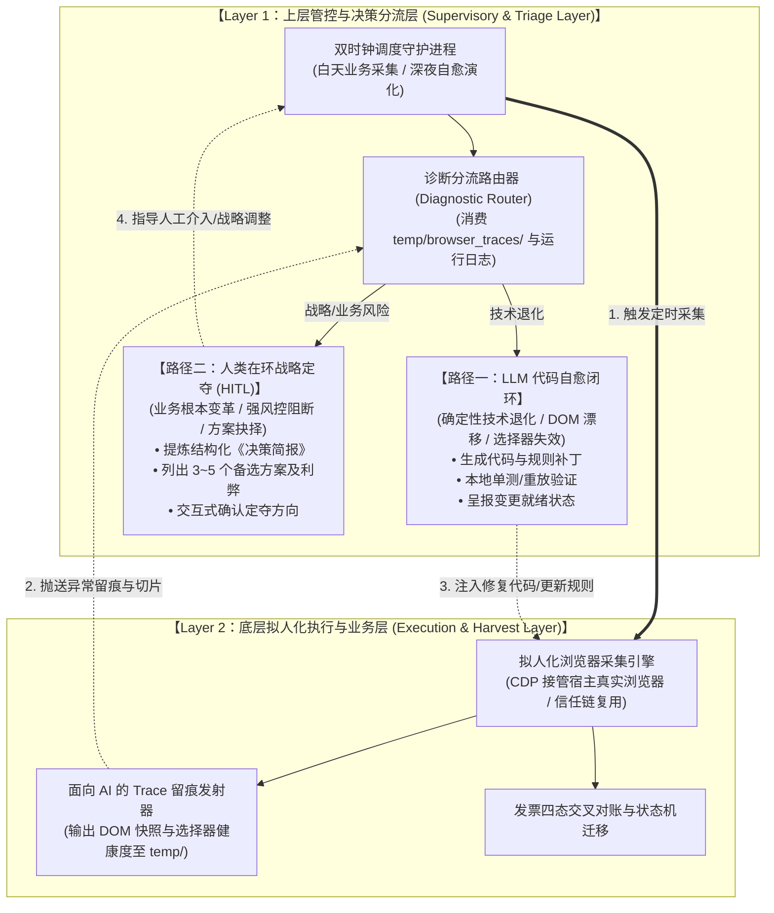
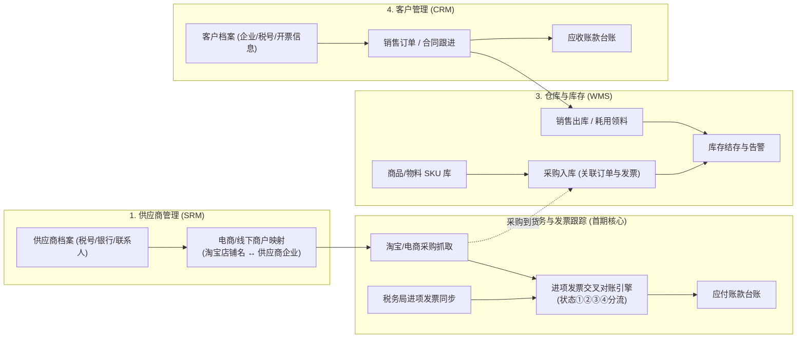
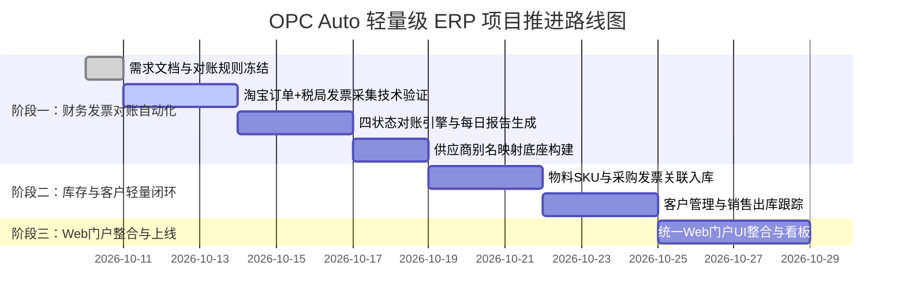

# OPC Auto - 轻量级 ERP 与办公自动化系统总体架构设计说明书

| 文档版本 | 状态 | 编写日期 | 架构定位 |
| :--- | :--- | :--- | :--- |
| v1.0.0 | 规划中 | 2026-10-10 | 企业轻量级 ERP 业务矩阵与统一自动化门户 (ERP + Automation Platform) |

---

## 一、 系统定位与设计哲学

本项目为公司量身打造一套**轻量级、高度自动化、易扩展的现代 ERP 与运营管理系统**。
核心特点：
1. **轻量实用，拒绝冗余 (Keep It Simple & Agile)**：聚焦中小企业核心运转链条（供应商 ➔ 采购 ➔ 发票 ➔ 库存 ➔ 销售 ➔ 客户），不搞传统重型 ERP 复杂的审批繁琐流程。
2. **自动化驱动 (Automation-First)**：以定时巡检、网络抓取、税务数据自动核对等技术手段，最大程度替代手工搬砖与 Excel 人工登记。
3. **单页面聚合门户 (Unified Web Portal)**：各模块既可作为独立的应用服务运行，又在同一个现代 Web 门户界面中平滑无缝切换。

---

## 二、 系统总体双层架构与运行拓扑 (Two-Tier Architecture & Dual-Path Triage)

为了彻底解决电商平台频繁改版、反爬阻断以及数据采集的高维护成本问题，系统在架构上明确划分为**两大核心层级**：

### 2.1 双层职责划分与通信契约
1. **上层 (Layer 1) - 大脑与司令部**：
   - 负责整体调度节奏、系统生命周期编排与健康度巡检；
   - 严禁参与具体的底层 DOM 抓取与浏览器 CDP 交互细节；
   - 核心组件为 **Diagnostic Router（诊断分流器）**，基于底层产出的 Trace 留痕进行智能分流判定。
2. **底层 (Layer 2) - 感知与执行器**：
   - 负责拟人化滚动、异步组件渲染等待、发票下载与税务数据匹配；
   - 遇到页面异动时不盲目死循环或隐瞒错误，严格输出包含现场切片的结构化诊断报告（`temp/browser_traces/trace_*.json`），向上抛送至 Layer 1。

### 2.2 诊断分流判定矩阵 (Dual-Path Triage Matrix)

| 判定维度 | 路径一：LLM 自主修改代码闭环 | 路径二：人类在环定夺战略方向 (HITL) |
| :--- | :--- | :--- |
| **触发特征** | 选择器命中数为 0、类名哈希漂移、按钮升级为链接、字段名微调 | 触发滑动验证码/扫码/人脸识别、平台取消线上开票入口、法律合规风险 |
| **处理方式** | LLM 消费 Trace 切片，重构选择器或修复清洗逻辑，本地运行回归测试 | 系统中断重试，自动生成包含成因与 3~5 个候选方案的《决策简报》 |
| **权责归属** | AI 自主闭环修复，呈报变更摘要，工作区就绪等待确认 | 用户拍板决策，决定是人工扫码接管还是切换线下导出模式 |
| **Git 权限** | **严禁自动 commit**，修改保留在工作区等待用户指示 | 方案选定后由用户决定何时推进与提交 |

---

## 三、 核心业务模块矩阵与数据流转

---

## 四、 四大业务模块功能详细规划

### 4.1 供应商管理模块 (Supplier Relationship Management)
- **供应商档案库**：记录供应商全称、统一社会信用代码（纳税人识别号）、开户银行、银行账号、地址电话、对接业务员等。
- **商户别名与平台映射表 (Smart Mapping)**：
  - *痛点解决*：淘宝店铺名称（如“某某数码专营店”）往往与其实际开票的企业名称（如“深圳市某某科技有限公司”）不一致。
  - *映射机制*：维护“平台商户/店铺名称 ↔ 真实开票销方企业”映射字典，系统能根据历史匹配经验自动学习并补齐映射关系。
- **应付账款与账期管理 (AP)**：记录向供应商的采购金额、已付金额、待付金额及账期提醒。

### 4.2 库存与仓储管理模块 (Inventory Management)
- **物料/商品主数据 (SKU/Catalog)**：
  - 编码、品名、规格型号、单位、安全库存阈值、成本单价。
  - 分类管理：固定资产、日常耗材、生产原料、转售商品。
- **采购入库联动 (Inbound Tracking)**：
  - 支持直接将淘宝采购订单/线下已核实发票关联转化为“采购入库单”，一键入库更新库存数量。
- **出库与领用记录 (Outbound Tracking)**：
  - 内部领料出库、项目耗用、销售发货出库。
- **库存盘点与预警**：
  - 实时库存看板；低于安全库存自动高亮预警；每日/每月库存台账快照。

### 4.3 客户管理模块 (Customer Relationship Management)
- **客户档案管理**：客户企业名称、纳税人识别号、客户级别、开票信息、联系人及沟通记录。
- **销售与订单跟踪**：销售意向、合同订单、发货状态跟进。
- **应收账款与销项发票 (AR)**：跟踪销售款项回款进度与销项发票开具状态。

### 4.4 财务发票与对账自动化模块 (首期落地攻坚)
- **进项发票全自动跟踪**（详情见 [01_财务发票跟踪系统需求说明书.md](file:///d:/Software/opc_auto/docs/01_财务发票跟踪系统需求说明书.md)）：
  - 淘宝采购记录自动抓取
  - 淘宝发票自动/一键催开
  - 国家电子税务局进项发票底账同步
  - 四态对账引擎（①线下发票、②淘宝待申请、③已申请未到票、④配对闭环）
  - 每日晚间 20:00/21:00 定时执行并产出汇总报告与异常告警

---

## 五、 统一 Web 门户与交互体验设计

- **统一工作台 (Portal Layout)**：
  - 顶部/侧边栏：模块快捷切换导航（`📊 概览仪表盘`、`💰 财务与发票`、`🏭 供应商`、`📦 库存管理`、`👥 客户管理`、`⚙️ 系统设置`）。
  - 各模块虽然在逻辑代码上高度解耦（独立路由/组件），但界面保持高度统一的视觉设计风格（现代深浅色配色、平滑微动画、卡片化布局）。
- **自动化监控卡片 (Automation Status Banner)**：
  - 门户顶部常驻展示自动化机器人运行状态：“上次巡检时间：昨晚 21:00，成功核对发票 18 笔，异常待办 2 笔”。

---

## 六、 实施路线图 (Roadmap)

