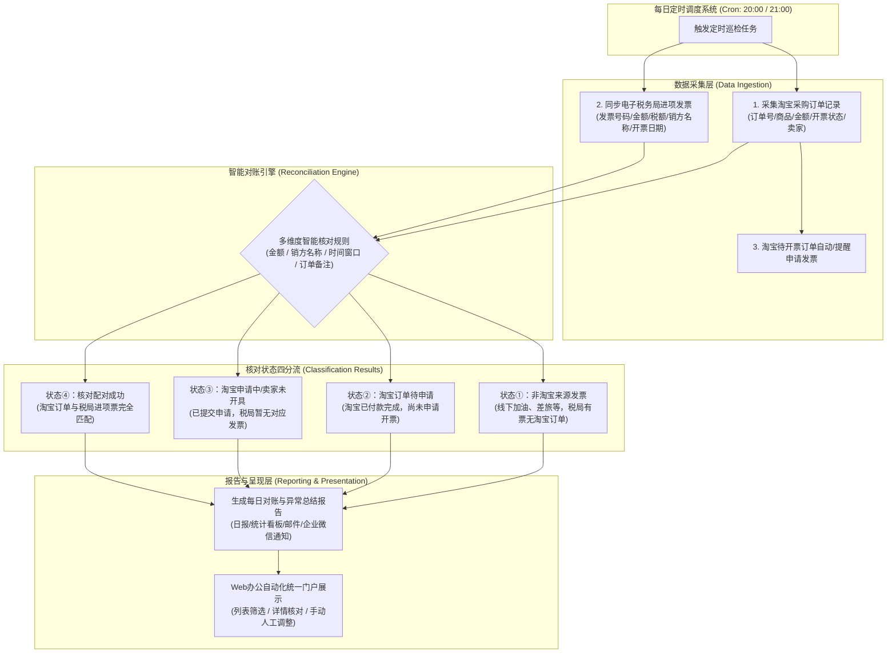

# 财务部 - 采购进项发票智能跟踪与核对系统需求规格说明书 (PRD)

| 文档版本 | 状态 | 编写日期 | 关联系统/模块 |
| :--- | :--- | :--- | :--- |
| v1.0.0 | 需求确认中 | 2026-10-10 | OPC Auto / 财务自动化模块 (Finance Invoice Tracker) |

---

## 一、 项目背景与建设目标

### 1.1 业务背景
在公司日常经营运作中，企业存在大量的线上（如淘宝企业采购、办公用品/耗材/设备采购）及线下（加油、差旅、餐饮、租赁等）采购支出。财务团队在处理采购发票（进项发票）时，普遍面临以下痛点：
1. **多源数据分散**：采购订单记录在电商平台（如淘宝），而进项发票抵扣/接收在国家税务总局全国增值税发票查验平台/电子发票服务平台（数电票系统）。
2. **跟票周期漫长**：电商平台部分卖家不主动开票，需人工频繁跟进申请；申请后可能存在开票延迟、开票抬头错误、金额不一致等情况。
3. **核销对账繁琐**：人工逐笔核对订单与税局发票耗费大量财务人力，容易出现漏开票、漏抵扣、重复报销或账实不符的情况。

### 1.2 建设目标
打造**全自动化、定时巡检的进项发票智能跟踪与核对引擎**，集成至公司统一 Web 办公自动化门户：
- **数据自动归集**：自动抓取淘宝采购记录与电子税务局进项发票底账库数据；
- **智能交叉对账**：自动进行订单与发票的特征比对，精确分类为 4 种业务场景；
- **定时无人值守**：每日固定时间（晚 20:00 / 21:00）全自动运行并输出对账日报，提供风险预警。

---

## 二、 总体业务流程架构

---

## 三、 详细功能需求说明

### 3.1 淘宝采购记录采集与发票申请模块
1. **采购订单数据获取**：
   - 抓取字段：淘宝订单号、下单时间、店铺/卖家名称、商品摘要、支付金额、退款金额、当前订单交易状态。
   - **多账号归集（已确认）**：公司采购使用**多个员工账号**分散下单，采集系统必须支持多账号会话管理（每个账号独立浏览器 Profile 独立保持登录态），订单记录必须归属标记**采购人账号**字段，台账支持按账号维度筛选与统计。
   - 抓取发票信息：平台记录的开票状态（未申请 / 申请中 / 已开票）、发票类型（电子专票/普票）、发票下载链接/PDF。
2. **发票自动申请与跟踪**：
   - 识别所有“已收货/已完成”且“未开票”的采购订单。
   - 对支持系统在线开票的订单，自动或批量填报企业开票抬头信息并提交申请；对需要联系客服或不支持线上申请的订单标记为待人工跟进。

### 3.2 电子税务局进项发票采集模块
1. **税局数据同步范围**：
   - 数据源：国家税务总局全国增值税发票查验平台 / 电子发票服务平台（数电票底账库）。
   - 目标范围：当前企业的**进项发票（采购受票数据）**，排除销售开出销项发票。
2. **采集关键字段**：
   - 发票代码、发票号码、数字账户票据 ID、开票日期。
   - 销方税号、销方名称（销售商户/企业全称）。
   - 金额（不含税）、税率、税额、价税合计金额。
   - 发票状态（正常、作废、红冲）、发票类型（数电专票、数电普票、纸质专票/普票）。

### 3.3 智能对账核对引擎 (核心)
引擎每天将已抓取的**淘宝订单集合**与**税局进项发票集合**进行交叉对验。结果划分为以下四大标准状态：

| 状态类型 | 状态名称 | 判定逻辑 | 业务处理动作 |
| :--- | :--- | :--- | :--- |
| **状态 ①** | **非淘宝来源发票 (线下/其他渠道)** | 税局底账库有该进项发票，但在淘宝订单池中未找到任何匹配记录（如：加油站中石化/中石油、线下餐饮、租金、线下采购等）。 | 归入“线下/其他进项发票库”，支持手动打标（如“车辆加油费”、“差旅费”）并归档。 |
| **状态 ②** | **淘宝订单待申请发票** | 淘宝订单已交易完成，但平台状态显示“未申请发票”，税局端也无匹配记录。 | 列入催办清单，触发自动申请程序或提醒采购人员一键批量提交发票申请。 |
| **状态 ③** | **淘宝已申请/卖家未开具 (开票异常)** | 淘宝已提交开票申请（或超约定开票时限），但在税局底账库中仍未查询到对应进项票。 | 标记为“催票中”；若超期（如超过 3~7 天），高亮预警提示财务或采购联系淘宝商家催开。 |
| **状态 ④** | **核对配对成功 (已开票闭环)** | 淘宝订单金额、商家抬头/信息与税局进项发票完全匹配，发票状态正常。 | 自动关联绑定“淘宝订单号 ↔ 税局发票号码”，归档入库，标记对账完毕。 |

> **匹配规则算法**：
> - 强关联匹配：若淘宝发票已开具，直接使用发票号码与代码进行精确比对；
> - 模糊启发式匹配：在未录入票号情况下，通过【价税合计金额 ＝ 订单实付金额】 ＋ 【下单日期与开票日期在合理时间窗口（如 ±15 天）】 ＋ 【淘宝卖家认证企业名称 ＝ 销方名称】进行智能权重匹配。

### 3.4 定时任务调度与每日总结报告
1. **定时执行机制**：
   - 调度配置：每天晚上固定时间执行（如 20:00 或 21:00 可配置）。
   - 任务内容：拉取当日增量数据 → 全量未归档订单对账比对 → 生成结构化报表。
2. **每日总结报告 (Daily Reconciliation Report)**：
   - **核心概览**：当日新增采购笔数、当日新增税局到票数、成功匹配笔数及金额。
   - **分类统计卡片**：
     - ① 非淘宝支出发票：共 X 笔，合计 ￥XX 元（附清单）；
     - ② 淘宝待申请发票：共 X 笔，合计 ￥XX 元；
     - ③ 淘宝已申请未到票：共 X 笔（其中超期 X 笔），合计 ￥XX 元；
     - ④ 配对成功发票：共 X 笔，合计 ￥XX 元。
   - **推送渠道**：生成可视化 Web 报表页面，并支持自动发送至指定邮箱 / 企业微信 / 钉钉群通知。

### 3.5 Web 综合管理后台（办公自动化门户子系统）
作为公司未来多模块 OA 的第一个模块，应具备：
- **仪表板 (Dashboard)**：当日对账成果、待处理红点提醒、月度发票抵扣趋势。
- **采购与发票明细台账**：支持按时间、金额、状态①②③④、商家等维度筛选、导出 Excel。
- **人工核对与手动绑定**：针对特殊拼单、多笔订单合并开票或金额微量差异，提供手动关联/解绑功能。
- **系统配置**：淘宝账号管理、税局证书/配置、定时任务执行时间设置、预警推送配置。

### 3.6 与轻量级 ERP 其他模块的业务联动机制
- **与【供应商管理 (SRM)】联动**：
  - 自动通过税局发票的销方税号/销方全称，自动匹配或新建供应商档案；
  - 建立“淘宝店铺名 ↔ 真实开票销方公司”映射字典，后续自动识别同类商户。
- **与【库存管理 (WMS)】联动**：
  - 状态④（核对配对成功）的采购订单，可一键或自动生成“采购入库单”，物料自动进入库存管理流转，无需重复录入。

---

## 四、 关键技术选型与实现路径探讨

| 环节 | 方案选项 A（推荐方案） | 方案选项 B（备选/过渡方案） | 注意事项与风控 |
| :--- | :--- | :--- | :--- |
| **淘宝采购数据采集** | **RPA / Headless 浏览器自动化** (Playwright / Selenium + 本地保持登录 Session) | **淘宝开放平台 API** / 订单账单 CSV 手动或半自动导入 | 淘宝有高强度的滑块风控与登录态校验，需持久化 Cookie 与扫码鉴权机制。 |
| **税务局进项发票采集** | **电子发票平台 (数电票) 自动化同步** (模拟登录电子税务局 / 浏览器自动化抓取) | **税局发票底账 Excel 批量导入** / 官方直连 API (如具备税企直连资质) | 电子税务局需要法人/财务人员扫码或 U-key 登录，需支持 Cookie/Token 复用与定时续期。 |
| **定时调度服务** | **Python 后端 (FastAPI + APScheduler / Celery)** | **操作系统原生定时任务 (Windows Task Scheduler)** | 需具备任务失败重试、执行日志追踪与告警机制。 |
| **前端 Web 架构** | **现代响应式 Web 控制台 (独立应用，微前端/路由集成到主 OA 门户)** | **一体化轻量单页 Web 应用 (SPA)** | 遵循统一 Design System，色彩雅致，提供高级深色/浅色模式与流畅交互。 |

---

## 五、 后续需要与您确认的关键细节

为了确保开发方案完全符合贵公司的实际工作流，建议确认以下几点：
1. **淘宝账号情况（✅ 已确认 2026-10-12）**：公司淘宝采购采用**多个分散的员工账号**下单。采集层须支持多账号会话管理（独立浏览器 Profile / Cookie 池），订单数据须归集到统一台账并标记采购人账号。
2. **税务局登录鉴权方式**：目前贵公司登录电子税务局主要采用**电子税务局网页人脸扫码**、**账号密码+手机验证码**，还是插**税务 U-key / 盘**？
3. **发票申请自动化程度**：淘宝发票申请是否需要完全自动化点击“申请发票”，还是由系统输出“待申请清单”后人工一键或在网页上确认？
4. **报表推送方式**：除了在 Web 页面上查看报表，是否需要每天将汇总结果推送到您的**企业微信、钉钉或电子邮箱**？
