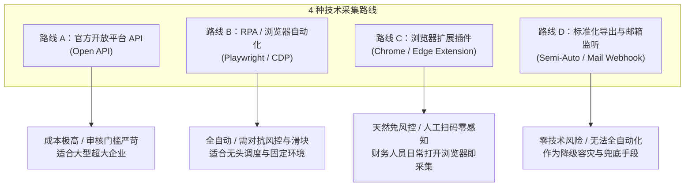
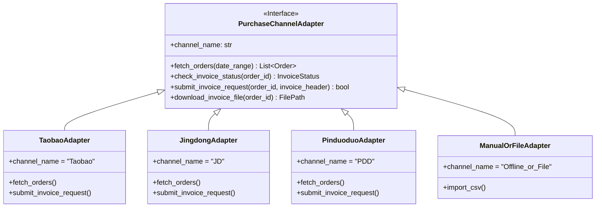

# 多平台采购发票采集方案头脑风暴与技术路线选型 (Brainstorming & Technical Trade-offs)

| 文档版本 | 状态 | 编写日期 | 适用系统 |
| :--- | :--- | :--- | :--- |
| v1.0.0 | 方案研讨与决策中 | 2026-10-10 | OPC Auto · 采购与发票自动化中台 |

---

## 一、 背景与头脑风暴核心命题

在实际企业运营中，采购渠道通常多元化（**淘宝/天猫、京东、拼多多、1688** 等），发票开具规则各异。
要实现“每日自动化巡检拉取订单、申请发票、核对进项”，首要技术卡点在于：
> **在各大电商平台的风控、授权和接口壁垒下，采用何种采集方式性价比最高、稳定性最强、维护成本最低？**

---

## 二、 主流采购平台发票生态特征剖析

| 平台 | 开票规范度与特点 | 常见发票形式 | 采集与操作难点 |
| :--- | :--- | :--- | :--- |
| **京东 (JD)** *(自营 + POP)* | **极高**（自营商品发票几乎 100% 自动秒开；POP 商家大多支持线上申请） | 电子专票 / 电子普票 (PDF/OFD 直链) | 自营有统一发票中心，但有登录态风控（京东验证码）；京东企业购有较完善的 API 体系。 |
| **淘宝 / 天猫** | **中等**（天猫及规范商家可线上申请；集市店小卖家常需人工旺旺索要） | 阿里发票平台、第三方开票直链、PDF | 风控极强（阿里设备指纹、滑动拼图、账号登录态易失效）；部分商户需手动留言抬头。 |
| **拼多多 (PDD)** | **偏低**（小微个人商家占比高，开票意愿低，常需订单完成后人工催促） | 商家私聊发送网盘/邮箱/图片，部分支持电子发票 | 网页端功能较简陋（重度偏向移动端），缺乏统一集中的发票中心，爬取和自动化难度最大。 |
| **1688 (阿里企业批)** | **较高**（企业 B2B 采购为主，多数默认支持增值税专票） | 数电专票 / 传统专票 | 同阿里系风控；很多支持账期与月结发票，存在多订单合并开票场景。 |

---

## 三、 4 种技术路线深度对比与可行性权衡

### 3.1 路线 A：官方开放平台 API 方式 (Open API)
- **实现原理**：申请淘宝开放平台、京东联盟/企业购开放平台、拼多多开放平台的开发者资质，使用 OAuth 2.0 获取企业 Token 调用订单及发票 API。
- **优势**：
  - 官方通道，数据极度稳定，绝对不封号，无滑块风控问题；
  - 适合服务端后台每日 20:00/21:00 定时静默轮询。
- **劣势与门槛**：
  - **资质壁垒极高**：淘宝/拼多多对“自研 ERP 获取买家订单”的权限审核极度严苛，通常只向知名 ISV 软件商开放，中小企业自研申请极难批复；
  - **接口付费与鉴权维护**：部分平台接口按次收费，且 Token 刷新机制复杂。
- **结论**：**不推荐作为起步方案**，难度和资质申请周期不可控。

---

### 3.2 路线 B：RPA / 无头与有头浏览器自动化 (Playwright / Selenium + CDP)
- **实现原理**：在服务器或财务本地主机上运行自动化脚本，基于持久化 UserDataDir（保持登录 Session / Cookie）模拟打开各电商网页，爬取订单页与发票页面，执行点击“申请发票”。
- **优势**：
  - 纯自动化无人值守，可直接由 Python 后端定时任务（每晚 20:00/21:00）唤醒执行；
  - 模拟真实人类操作，能做到自动批量点击“申请开票”。
- **劣势与挑战**：
  - **登录态失效**：电商平台通常 7~30 天强制要求重新扫码验证；
  - **滑块与人机校验**：阿里系、拼多多的前端 JS 风控会检测 WebDriver 指纹（需做反反爬隐藏 `navigator.webdriver`）；一旦跳出滑块，全自动流程会中断，需人工介入滑块。
- **优化对策**：采用 **CDP (Chrome DevTools Protocol) 附着模式** —— 财务平时就在专用的 Chrome 浏览器中登录着淘宝/京东，自动化程序到点直接接管该浏览器窗口，无需重复登录。

---

### 3.3 路线 C：轻量级浏览器扩展插件模式 (Chrome / Edge Extension) ⭐ (极具潜力方案)
- **实现原理**：开发一个轻量级 Chrome 扩展。财务人员平时办公打开淘宝/京东/拼多多网页时，插件直接在浏览器内注入脚本：
  - 一键把当前已登录账号的“买家订单列表”及“发票状态”直接抓取并推送回本地 OPC Auto 后端；
  - 甚至在网页上注入“一键全自动催票/申请发票”按钮。
- **优势**：
  - **完全免疫登录风控**：完全依托财务本人的真实浏览器、真实 IP、真实指纹，各大电商平台根本不会产生风控拦截；
  - **零账号泄露风险**：后端无需存储财务或法人的电商账号密码；
  - **开发成本低、上线极快**：无需申请任何第三方 API 权限。
- **劣势**：
  - 无法做到 100% “电脑关机也能后台跑”——需要财务人员开着浏览器或在白天工作时触发采集，晚上 21:00 后端主要执行**数据对账和生成报告**。

---

### 3.4 路线 D：标准化导出与发票邮箱监听 (兜底与降级模式)
- **实现原理**：
  - 电商平台均支持一键“导出订单 CSV/Excel”；
  - 京东、淘宝开出的电子发票大多会发送至指定的“企业公共发票邮箱”；后端系统只需定时轮询该收件箱，自动解析 PDF/OFD 发票。
- **价值**：
  - 当某个平台（如拼多多）风控收紧、页面改版时，作为 100% 可用的应急保底通道。

---

## 四、 平台适配器抽象架构设计 (Adapter Pattern)

为了避免业务系统与特定平台强耦合，系统后端设计抽象**采购通道适配器接口 (Purchase Channel Adapter)**：

---

## 五、 推荐的混合落地路径 (Hybrid Practical Approach)

针对各平台的实际门槛，建议采取 **“主流平台深做，长尾平台兜底”** 的分级推进策略：

| 平台 | 推荐实施方案 | 说明 |
| :---: | :---: | :--- |
| **京东 (JD)** | **RPA 脚本 或 浏览器插件抓取** | 京东自营开票规范，数据结构极标准，优先跑通自营秒开秒配。 |
| **淘宝 / 天猫** | **CDP 浏览器自动化 / 插件** | 解决阿里系极验风控，首期先跑通订单与发票状态提取，再逐步推进自动点击申请。 |
| **拼多多 (PDD)** | **插件捕获 ＋ 订单导出导入** | 拼多多开票很多无线上入口，先抓取订单池做对账，无法线上申请的直接出预警提示人工催票。 |
| **电子税务局** | **数电票底账查询导出 / 模拟拉取** | 作为唯一的受票最终权威源，获取所有合法开出的进项增值税发票。 |
| **通用发票邮箱** | **IMAP 定时自动抓取发票 PDF** | 各平台开出发票发送到公司指定发票邮箱时，自动下载解析并关联订单。 |

---

## 六、 讨论题点与确认清单

1. **多平台优先级排序**：淘宝、京东、拼多多三者中，贵公司日常采购**单量和金额最大**的是哪一个？建议先以该平台为突破口打造 MVP。
2. **自动化运行环境**：后续定时跑自动化程序的机器，是**公司的某台固定办公电脑/财务电脑**，还是**公司云服务器**？
   *(注：电商平台和税务局通常对异地云服务器 IP 风控极严，运行在本地固定办公环境的电脑上成功率远高于云服务器)*。
3. **企业收票公共邮箱**：公司目前是否有一个统一接收电子发票的电子邮箱（如 `invoice@company.com`）？
