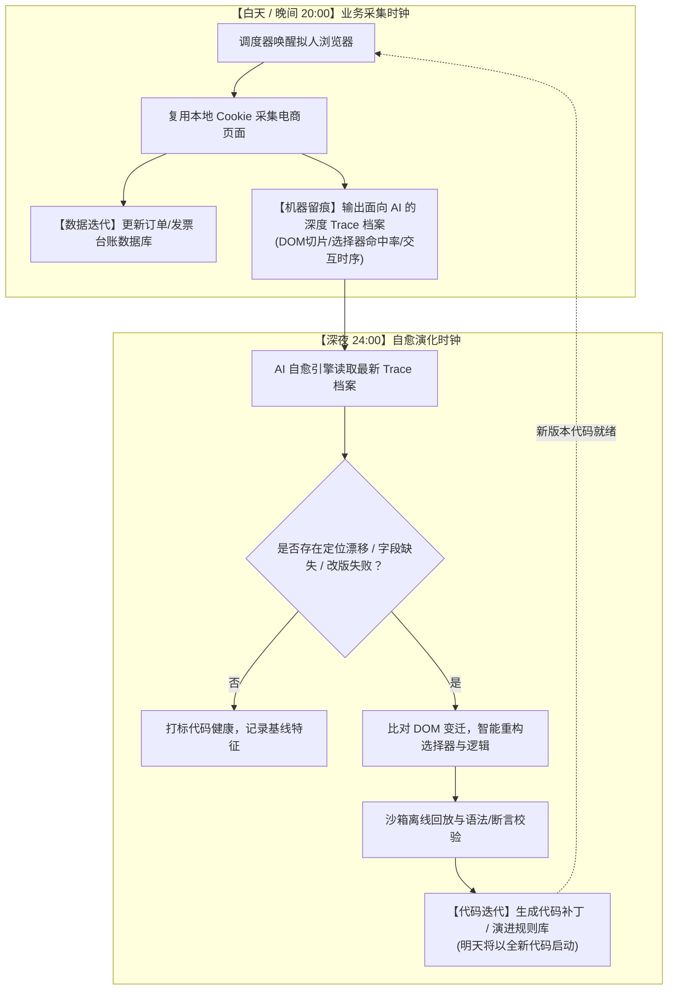

# 系统自我迭代闭环实施方案：数据与代码自演化架构 (Self-Evolving Architecture Plan)

| 文档版本 | 状态 | 编写日期 | 核心目标 |
| :--- | :--- | :--- | :--- |
| **v1.0.0** | 方案规划与立项 | 2026-10-10 | 构建每日自闭环运行体系，实现“今日运行的程序与明日运行的程序可能不同” |

---

## 🎯 一、 核心目标与哲学定义

在没有人工预录入真实业务单据的前提下，单纯依靠固定脚本无法应对电商平台（淘宝、京东等）频繁的前端重构、动态类名混淆和风控变化。

本方案的核心目标是**构建一个兼具“数据演化”与“代码自进化”的双轨自迭代闭环**：
> **“每一天运行一次，运行后产生专属机器日志；深夜分析前次运行日志并修改代码或配置；今天运行的程序和明天运行的程序可能会不一样。”**



---

## 🔄 二、 双轨自我迭代机制设计

### 1. 轨道一：数据维度的自我迭代 (Data Evolution)
数据迭代的本质是**让本地业务台账随着真实采购行为自动生长、沉淀与状态流转**：
- **增量滚动抓取**：
  - 不做无意义的全量拉取，每次采集仅滚动抓取过去 30~90 天内状态发生跃迁的订单；
- **全生命周期状态机迁移**：
  - 订单经历：`待付款 ➔ 已付款未发货 ➔ 已发货 ➔ 交易成功未开票 ➔ 已申请开票 ➔ 电子税局底账已同步 ➔ 自动对账归档`；
  - 每日运行都会促使这一链路向前推进，自动识别哪些订单“已到可开票状态”、哪些发票“已超时需催票”；
- **供应商知识库自学习沉淀**：
  - 自动从商品明细与店铺信息中提取供应商税号、销方全称，持续丰富企业主数据表（`suppliers`）。

---

### 2. 轨道二：代码维度的自我迭代 (Code & Logic Self-Evolution)
代码迭代的本质是**将易变的前端解析与交互策略从硬编码中解放，使其具备感知变迁、自我重写与热更新能力**。

我们将代码体系划分为两层演化模型：

```
┌────────────────────────────────────────────────────────┐
│               代码自演化分层架构 (Two-Layer Model)       │
├──────────────────────────┬─────────────────────────────┤
│ 外层：声明式规则库       │ • 选择器矩阵 (Selectors Matrix)     │
│ (Dynamic Rule Layer)     │ • 关键锚点文本 (Keyword Anchors)    │
│ [90% 变迁场景自愈]       │ • 翻页与等待时序策略                │
├──────────────────────────┼─────────────────────────────┤
│ 内层：交互逻辑执行器     │ • 页面导航与 CDP 连接调度           │
│ (Core Script & Patches)  │ • 复杂交互流 (弹窗/多Tab跳转)       │
│ [10% 重构场景代码补丁]   │ • 版本控制与自动回滚沙箱            │
└──────────────────────────┴─────────────────────────────┘
```

#### A. 规则层自愈（最安全、高频的自我修改）
- 选择器和交互规则独立解耦为 `rules/{platform}_rules.json`；
- 当夜间 AI 发现 `invoice_btn` 选择器失灵，而页面快照中出现了符合语义的新元素时，**直接重写规则配置**，赋予其新的定位链路与 fallback 链；
- 次日运行直接加载全新规则，实现零停机、无风险演进。

#### B. 核心逻辑代码热补丁（深层结构变动自愈）
- 若电商平台发生了交互流层面的大改版（如原本的页面直显变成 iframe 嵌套或异步弹窗），规则层无法应对；
- AI 诊断器将自动输出针对 `src/collectors/{platform}_collector.py` 的代码 Diff 补丁；
- **版本快照控制**：自动留存历史快照（`v1`, `v2`, `v3`），每次修改均进行语法树（AST）校验和单元回归测试；若次日运行发生未知崩溃，自动熔断回滚至上一个稳定版本。

---

## 📋 三、 面向 AI 的深度 Trace 遥测规范 (The Diagnostic Telemetry)

要让 AI 在夜间能够自主“修改代码”，必须为其提供完备的“案发现场病历”。

每次采集运行时，系统在 `temp/browser_traces/` 产出两类资产：
1. **结构化时序日志 (`trace_{date}.json`)**：
   - 记录每一轮操作的目标、使用到的选择器、定位耗时、DOM 命中节点数；
   - 记录成功提取的字段完整度评分（如：金额提取率 100%，开票状态提取率 0% ➔ 触发红灯警报）。
2. **变异切片现场快照 (`snapshot_{step}.html` / `tree.json`)**：
   - 当任何一个字段提取失败或选择器命中数为 0 时，捕获当前可视区域的 DOM 结构简化树（清除无关样式与内联脚本，只保留结构标签、文本和属性）；
   - 为深夜诊断提供最精确的上下文，AI 无需重新打开浏览器即可“盲操”分析出新的选择器。

---

## ⏰ 四、 双阶段时钟体系运行流程 (Dual-Clock Cadence)

系统常驻守护线程内新增**“自迭代双时钟”**控制：

| 时钟阶段 | 时间点 (可配置) | 角色定位 | 核心输入/输出 |
| :--- | :--- | :--- | :--- |
| **时钟 1：采集时钟** | **每日 20:00** | 业务生产 | **输入**：真实浏览器会话<br>**输出**：新订单/发票数据、`Trace` 遥测日志、DOM 异常快照 |
| **时钟 2：演化时钟** | **每日 24:00** | 代码自我进化 | **输入**：20:00 产生的 Trace 与快照<br>**输出**：改版诊断报告、自愈后的选择器规则或代码补丁 |

---

## 🛠️ 五、 实施路线图与推进计划 (Implementation Roadmap)

```
┌────────────────────────────────────────────────────────────────────────┐
│                        自我迭代系统落地四步走                          │
├───────────────┬────────────────────────────────────────────────────────┤
│ 阶段一 (基石) │ 搭建真实浏览器挂接驱动器 (CDP) + 机器级 Trace 遥测记录器│
│               │ • 接管 Chrome/Edge 9222 端口，复用现有登录 Cookie      │
│               │ • 实现全链路执行留痕与 DOM 变异快照输出                │
├───────────────┼────────────────────────────────────────────────────────┤
│ 阶段二 (数据) │ 采购数据生命周期流转与数据库持续沉淀                   │
│               │ • 实现订单增量爬取、去重与状态机跃迁                   │
│               │ • 建立供应商主数据自学习入库机制                       │
├───────────────┼────────────────────────────────────────────────────────┤
│ 阶段三 (演化) │ 规则外部化解耦与深夜自愈诊断引擎                       │
│               │ • 提取选择器为独立可演进规则库                         │
│               │ • 编写夜间 Trace 分析器：自动发现失效点并重写规则库    │
├───────────────┼────────────────────────────────────────────────────────┤
│ 阶段四 (自愈) │ 代码级热补丁与沙箱验证闭环                             │
│               │ • 实现交互逻辑的代码生成与版本化快照                   │
│               │ • 引入自动语法校验与熔断回滚保护机制                   │
└───────────────┴────────────────────────────────────────────────────────┘
```
