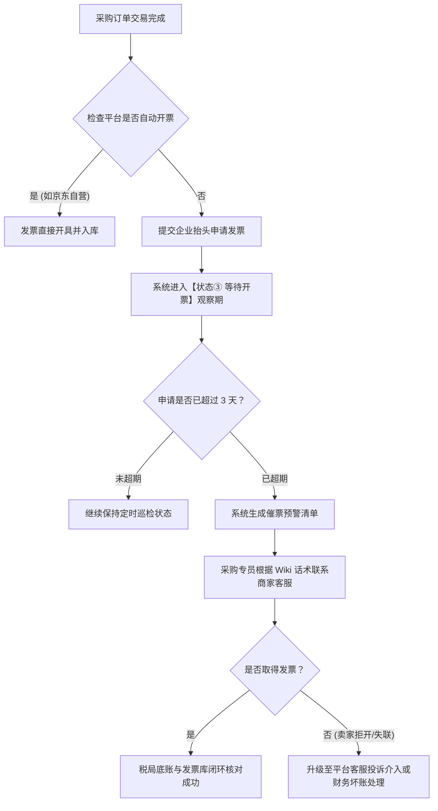

# 采购平台与发票获取全景指南 (Procurement Platforms & Invoicing Manual)

> **使用说明**：
> 本手册详细梳理了公司日常线上采购平台、电商平台及线下高频支出渠道的发票开具入口、开票规则及异常催票技巧，为自动化脚本爬取规则及人工财务跟票提供标准化知识库。

---

## 一、 主流电商采购平台发票获取指南

### 1. 淘宝网 / 天猫 (Taobao / Tmall)
- **官方网址**：[https://www.taobao.com](https://www.taobao.com)
- **买家订单与发票入口**：
  - 网页端：【我的淘宝】➔【已买到的宝贝】➔ 找到对应订单 ➔ 点击【申请开票】或【查看发票】
  - 手机端：【我的淘宝】➔【我的订单】➔【查看发票 / 开具发票】
- **发票形式**：阿里发票平台电子发票 (PDF)、商家直接发送的电子发票、极少部分纸质寄送专票。
- **开票规则与时效**：
  - 天猫旗舰店/专营店：下单时勾选“需要发票”后，通常在确认收货后 24~48 小时内自动开具；
  - 淘宝集市小店：若订单无“申请开票”按钮，需通过“旺旺客服”向商家提供企业抬头及邮箱催开；
- **自动化爬取建议**：
  - 重点抓取 `trade.taobao.com/trade/itemlist/list_bought_items.htm` 中的“发票详情”浮层与订单开票状态。

---

### 2. 京东商城 / 京东企业购 (JD.com)
- **官方网址**：[https://www.jd.com](https://www.jd.com) | 企业购：[https://b.jd.com](https://b.jd.com)
- **发票服务入口**：
  - 网页端：【我的京东】➔【订单中心】➔【我的发票】([order.jd.com/center/invoice.action](https://order.jd.com/center/invoice.action))
- **发票形式**：数电电子专票、数电电子普票 (PDF/OFD 原件直接下载)。
- **开票规则与时效**：
  - **京东自营商品**：规范度极高，商品出库/妥投后数分钟至2小时内系统自动开具，发票抬头自动绑定企业增票资质；
  - **第三方 POP 店铺**：需在订单详情或发票中心点击“申请开票”，第三方卖家有 10 个工作日的处理期限。
- **自动化爬取建议**：
  - 京东发票中心接口规范度最好，可通过发票中心页面直接抓取发票代码、号码、金额以及 PDF 下载直链。

---

### 3. 拼多多 (Pinduoduo / PDD)
- **官方网址**：[https://www.pinduoduo.com](https://www.pinduoduo.com) (以手机 App 微信小程序为主)
- **发票获取入口**：
  - App 端：【个人中心】➔【我的订单】➔ 找到订单 ➔【申请发票】（仅部分支持电子发票的店铺展示）；
  - 网页版订单后台：`https://mobile.yangkeduo.com` 或商家私信客服。
- **开票规则与时效**：
  - 拼多多大量商家为个体工商业者，平台发票自动化程度较低；
  - 常见方式为联系客服，客服提供第三方开票二维码或登记企业邮箱后通过外部平台（如百望、航天信息）开具。
- **财务跟票对策**：
  - 凡拼多多采购订单，系统自动标记为“重点跟踪”，超期 3 天未获取发票时由采购专员在 App 内发起人工客服催办。

---

### 4. 1688 阿里巴巴采购批发网 (1688.com)
- **官方网址**：[https://www.1688.com](https://www.1688.com)
- **发票获取入口**：
  - 网页端：【我的阿里】➔【买家交易】➔【已买到货品】➔【发票管理】➔【申请发票 / 发票明细】
- **开票规则与时效**：
  - B2B 批发采购平台，大部分商家支持开具 13% 增值税专用发票；
  - 支持多笔订单合并开具单张发票（对账时需支持“多对一”订单金额合并匹配）。

---

## 二、 线下高频消费与费用类发票获取渠道

| 费用类别 | 推荐平台 / 微信公众号 | 官方开票路径 | 获取发票形式 |
| :--- | :--- | :--- | :--- |
| **公车加油 (中石化)** | **中国石化“易捷加油”App / 小程序** | 绑定企业加油卡或手机号 ➔【电子发票】➔ 选择加油记录一键开票 | 增值税电子普通发票 / 电子专票 (PDF 邮箱接收) |
| **公车加油 (中石油)** | **“中油好客e站”App / 小程序** | 绑定加油卡 ➔【发票中心】➔ 勾选充值或消费流水开票 | 数电电子发票 |
| **高速通行费 (ETC)** | **票根网 (www.txffp.com) / 票根小程序** | 绑定公司车辆 ETC 卡号 ➔ 申请增值税电子普通发票 (通行费) | 增值税电子普通发票 (用于进项抵扣) |
| **市内商务出行** | **滴滴出行 / 高德打车 企业版** | 【行程报销】➔ 勾选商务出行行程 ➔ 开具企业抬头电子发票 | 客运服务电子发票 |
| **商务出差 (高铁客票)** | **铁路 12306 App / 官网** | 2024年底已全面推行电子发票 ➔ 12306 个人中心 ➔【电子发票】下载 | 铁路电子客票 (数电发票) |
| **酒店住宿** | 携程商旅 / 酒店前台 | 离店时出示公司开票信息在前台开具，或离店后在 OTA 平台申请 | 增值税专用发票 (数电票) |

---

## 三、 发票状态流转与催票跟进标准操作规程 (SOP)

### 催票客服标准沟通话术：
> “您好！我是企业采购，订单号为【`TBxxxxxxxx`】，下单时已提交增值税专用发票（普通发票）申请，抬头为【`OPC 自动化科技有限公司`】，税号【`91310000XXXXXXXXXX`】。因公司月底财务报销结账封账，劳烦尽快开具并将发票原件发送至公司指定邮箱 `invoice@opc-auto.com`，非常感谢您的支持！”
