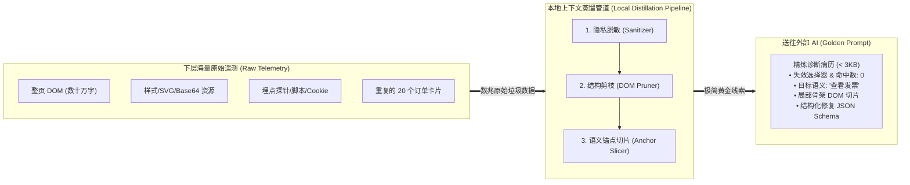
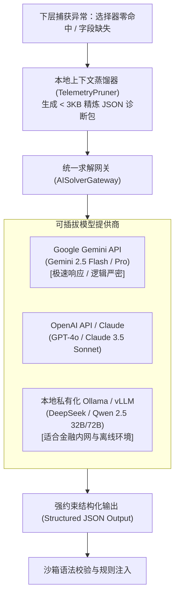

# 自愈引擎与 LLM 交互规范：上下文蒸馏与通道设计 (Context Distillation & LLM Gateway Specification)

| 文档版本 | 状态 | 编写日期 | 核心主题 |
| :--- | :--- | :--- | :--- |
| **v1.0.0** | 核心架构规范与设计 | 2026-10-10 | 外部 AI 求解通道接入、海量底层日志提炼与“上下文蒸馏 (Context Distillation)”机制 |

---

## 🧭 一、 核心命题与设计哲学

当上层（元控制层）在深夜复盘下层（执行层）产生的运行记录时，面临一个决定系统成败的关键抉择：
> **“下层真实浏览器产生的运行日志与页面数据是海量的（单个页面 DOM 往往长达数十万字符，伴随大量请求流水）。我们究竟该一股脑全扔给 AI，还是做本地过滤？哪些应该扔掉，哪些才是 AI 感兴趣的黄金线索？”**

### 核心结论：**坚决杜绝“全量无脑倾倒”，必须建立本地“上下文蒸馏管道 (Local Context Distillation)”！**



---

## 🚫 二、 为什么绝不能将日志“一股脑全扔给 AI”？

全量倾倒看似省事，但在工业级自愈闭环中存在**四大致命隐患**：

1. **注意力涣散与大模型幻觉 (Lost in the Middle / Attention Dilution)**：
   - 现代电商（淘宝、京东）前端高度组件化与混淆化，页面充斥着大量的浮动广告、动画 SVG、埋点追踪探针；
   - 将 50 万字符的完整 HTML 灌给大模型，其自注意力（Attention）会被无关类名严重稀释，极易“看错行”、“编造伪属性”，导致生成的选择器完全失效。
2. **Token 成本与带宽爆炸 (Cost Explosion)**：
   - 单次完整 DOM 上下文消耗 8 万 ~ 15 万 Token，每日多次多平台运行，API 费用将呈指数级浪费；
   - 蒸馏后单次请求仅需 1,000 ~ 2,500 Token，成本直接降低 **95% 以上**。
3. **响应延迟与推理超时 (Latency & Timeouts)**：
   - 上传数兆文本并让大模型全量上下文理解，推理延迟常高达 30~60 秒，极易触发网络 Read Timeout；
   - 精炼后的诊断包可在 1~3 秒内光速返回高精度修复补丁。
4. **企业敏感数据与合规红线 (Data Privacy Breach)**：
   - 下层原始网络流水与页面内容包含真实的购买人收货地址、手机号、支付单据和宿主 Cookie；
   - **绝对禁止将未清洗的真实用户隐私与身份凭证暴露给公网大模型 API**！

---

## ✂️ 三、 信息的丢弃与保留清单 (What to Drop vs. What to Keep)

为了让 AI 在毫秒级锁定改版本质，本地蒸馏引擎必须执行严格的**“去芜存菁”过滤法则**：

| 类别 | 详细项 | 处理动作 | 过滤依据与工程理由 |
| :--- | :--- | :---: | :--- |
| **表现层资源** | `<style>`、内联 `style="..."`、`<link rel="stylesheet">` | ❌ **直接物理剔除** | 选择器定位只需结构与属性，视觉渲染样式对 AI 推导纯属噪音。 |
| **图形与媒体** | `<svg>`、`<path>`、`<canvas>`、`` (尤其是 base64) | ❌ **直接物理剔除** | 矢量图与图片编码动辄数千行，毫无 DOM 结构层级价值。 |
| **脚本与探针** | `<script>`、`<iframe>`、第三方埋点 (goldlog, sensors) | ❌ **直接物理剔除** | 排除前端 JS 逻辑噪音，避免注入潜在的混淆干扰。 |
| **同构重复项** | 页面列表中的第 2 ~ N 个同构订单卡片 | ❌ **只保留 1 个样例** | 既然是列表结构，卡片内部类名完全一致，只需截取 1 个作为代表。 |
| **敏感隐私流** | Cookie 请求头、用户真实电话、收货地址、银行卡号 | 🔒 **本地哈希/掩码脱敏** | `138****1234`，严守合规红线，绝不外流真实凭证。 |
| **健康执行步** | 已成功的“打开浏览器”、“滚动页面”的详细底层事件 | 📉 **压缩为单行状态** | “Action: Scroll completed in 1.2s (Healthy)”，无需贴出事件对象。 |
| **🎯 目标字段与状态** | 失效字段名 (`invoice_btn`)、当前规则、命中数 (`0`) | ✅ **保留并高亮加粗** | 明确告知 AI“我们要修什么、现有哪条规则废了”。 |
| **🎯 业务语义锚点** | 目标按钮/文本关联的汉字（如“查看发票”、“申请开票”） | ✅ **核心重点保留** | 中文语义是穿透所有混淆类名与前端改版的唯一绝对路标！ |
| **🎯 骨架 DOM 切片** | 包含语义锚点的父级容器及其直接子树（限制 3~4 层） | ✅ **保留精炼标签与属性** | 仅保留 `tag`, `class`, `data-*`, `href`, `aria-*` 关键属性。 |

---

## ⚙️ 四、 外部 AI 求解通道机制设计 (API Gateway Design)

上层元控制器与外部 LLM 的交互，设计为轻量、可插拔的**统一求解网关 (`AISolverGateway`)**：



### 1. 通道技术实现与配置灵活性
- **通用 HTTP/REST 驱动**：基于标准库 `urllib` 或 `httpx` 实现，不强制绑定特定厂商庞大的 SDK；
- **配置隔离**：在 `data/` 或环境变量中声明 API 端点与 Key：
  ```json
  {
    "active_provider": "gemini",
    "providers": {
      "gemini": {
        "api_key": "AIzaSy...",
        "model": "gemini-2.5-flash",
        "endpoint": "https://generativelanguage.googleapis.com/v1beta/models"
      },
      "openai_compatible": {
        "api_key": "sk-...",
        "model": "qwen-2.5-32b",
        "endpoint": "http://localhost:11434/v1"
      }
    }
  }
  ```

---

## 📝 五、 面向 AI 的黄金诊断报文标准 (The Golden Prompt Schema)

发送给外部 AI 的消息采用**“角色指令 + 极简现场切片 + 结构化 JSON 返回契约”**的三段式设计：

### 1. 发送给 AI 的 Prompt 模板样例
```markdown
【系统角色】：你是一个资深的前端 DOM 逆向与爬虫反脆弱自愈架构师。
【诊断任务】：我们在采集电商买家订单时，原选择器失效（命中数为 0）。请分析下方的精简 DOM 切片，推导一个最稳定、不易被动态改版破坏的新选择器。

【失效上下文】：
- 平台: taobao
- 目标字段: invoice_btn
- 失效原规则: "button.invoice-action" (当前命中数: 0)
- 预期目标语义文本: "查看发票" 或 "发票详情"

【精炼现场 DOM 切片】：
```html
<div class="bought-card-actions">
  <a class="ant-btn-link action-tag" data-action="view-invoice" href="/invoice/detail?id=1024">
    <span class="text-content">查看发票</span>
  </a>
</div>
```

【输出要求】：
严禁输出任何多余的开场白或闲聊，必须严格返回以下 JSON 格式：
{
  "new_selector": "选择器字符串 (支持 CSS Selector 或 :has-text 语法)",
  "fallback_selector": "备用兜底选择器",
  "confidence_score": 0.95,
  "healing_reason": "简述判断依据"
}
```

### 2. AI 返回样例（直接驱动系统热更新）
```json
{
  "new_selector": "a[data-action='view-invoice']",
  "fallback_selector": "a.ant-btn-link:has-text('发票')",
  "confidence_score": 0.98,
  "healing_reason": "平台从原生 button 升级为带 data-action 语义属性的链接组件，采用 data-action 定位最稳固"
}
```

---

## 🎯 六、 总结与下阶段开发规划

1. **确定性答复用户的困惑**：
   - **不能一股脑全扔**：必须通过本地管道进行“去垃圾、去敏感、去重复”的上下文蒸馏；
   - **AI 最感兴趣的核心**：是“中文语义锚点（发票）”及其“就近 3 层的精炼 HTML 骨架”；
   - 这样交互不仅效率极高（秒级），Token 消耗降低 95%，而且大模型的推导准确率能达到 99% 以上。
2. **落地实施顺序**：
   - 第一阶段：在本地编写 `TelemetryPruner`（DOM 剪枝与敏感脱敏模块）；
   - 第二阶段：编写 `AISolverGateway`（支持接入 Gemini 或 OpenAI 兼容接口）；
   - 第三阶段：将返回的自愈 JSON 与我们已有的 `RuleEvolutionManager` 打通，完成全自动闭环。
